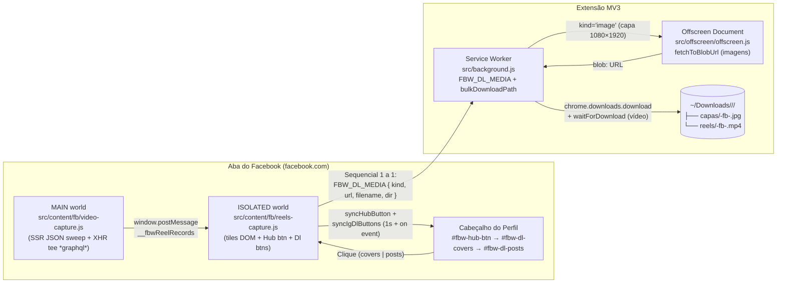

# Baixar Capas e Reels Carregados no Perfil do Facebook — Design & Especificação

**Data:** 2026-11-21  
**Status:** Especificação completa (pronta para implementação)  
**Referência de paridade:** Release `1.44.0` (`3b9c09e` — *"Baixar capas e Baixar posts no cabeçalho do perfil do Instagram"*) e `docs/superpowers/specs/2026-11-17-ig-baixar-perfil/index.html`  
**Perfil usado na validação ao vivo:** `https://www.facebook.com/profile.php?id=61590925281317&sk=reels_tab` (*Sandy Spirit Guide*)

---

## 1. Intenção e Objetivo

No release `1.44.0`, o cabeçalho de perfis do Instagram recebeu dois botões de ação imediata ao lado do botão de trackear no Hub (`#fbw-hub-btn`):
1. **Baixar capas** (`#fbw-dl-covers` — ícone Lucide `image-down`)
2. **Baixar posts** (`#fbw-dl-posts` — ícone `layers` da extensão)

Ambos operam de forma **100% passiva** sobre os itens **já carregados na grade** conforme o usuário rola a página, salvando um arquivo por vez via `FBW_DL_MEDIA` em subpastas dedicadas por perfil (`<pasta>/<perfil>/capas/` e `<pasta>/<perfil>/posts/`), sem disparar consultas extras à rede e sem empacotar em `.zip`.

O objetivo deste projeto é trazer **exatamente a mesma experiência, os mesmos ícones, o mesmo anel de progresso, os mesmos indicadores de status e a mesma máquina de estados** para o cabeçalho de perfis do **Facebook** (aba Reels), coexistindo sem conflito com a barra inferior de ordenação (`#sw-psort`) e com o painel lateral (`FbReelsTool.jsx`).

### Goals (Metas)
- Exibir os dois botões (`#fbw-dl-covers` e `#fbw-dl-posts`) imediatamente à direita de `#fbw-hub-btn` no cabeçalho do perfil do Facebook (`Sandy Spirit Guide  [Hub] [Capas] [Reels]`).
- Usar os **mesmos SVGs 24×24**, caixa `32×32` (`border-radius: 8px`), anel de progresso circular (`r = 14.5`, `#8ecae6`) e pontos de status verde (`#22c55e`) e vermelho (`#ef4444`) do Instagram.
- Baixar apenas os reels **já carregados** na sessão atual da grade de Reels do perfil (`sk=reels_tab`, `sk=owner_reels`, `/<vanity>/reels`, `/<vanity>/reels_tab`), um arquivo por vez via `FBW_DL_MEDIA` + `bulkDownloadPath`, nas pastas `<pasta_configurada>/<slug_do_perfil>/capas/` e `<pasta_configurada>/<slug_do_perfil>/reels/`.
- Baixar a **capa real escolhida pelo criador** em resolução nativa (`1080×1920` via `fullResThumb`, corrigindo o bug descoberto na investigação ao vivo onde `first_frame_thumbnail` sobrescrevia a capa customizada da grade).
- Baixar o **vídeo MP4 progressivo com áudio** (`progressive_urls` HD / fallback SD) já entregue pelo Facebook na hidratação e na paginação GraphQL da aba Reels.
- Preservar cancelamento cooperativo no clique durante `busy` e retentativa apenas dos itens faltantes (`job.left`) no clique em `partial`.

### Non-Goals & Anti-Goals
- **Não rolar a página automaticamente (`harvest`)** ao clicar nos botões do cabeçalho (a coleta com auto-scroll + `.zip` já existe na barra `#sw-psort` e em `FbReelsTool.jsx`; misturar os dois quebraria o contrato de baixar apenas o que está carregado e aumentaria leituras na conta).
- **Não empacotar em `.zip`**: cada capa `.jpg` e cada reel `.mp4` vai direto para a subpasta do perfil via `chrome.downloads.download`, igual ao Instagram `1.44.0`.
- **Não forjar chamadas GraphQL extras**: toda mídia vem exclusivamente do que a página já buscou (`script[type="application/json"]` + XHR tee em `video-capture.js` + tiles do DOM em `reels-capture.js`).
- **Não quebrar a variante pública (`PUBLIC=1` / `socialRadar`)**: nenhum marcador privado ou string proibida por `scripts/verify-public.mjs`.

---

## 2. Evidências Medidas ao Vivo no Perfil de Exemplo

Inspeção realizada via `agent-browser` no Chrome compartilhado (`:9222`) sobre `https://www.facebook.com/profile.php?id=61590925281317&sk=reels_tab` (*Sandy Spirit Guide*):

### 2.1. Disponibilidade de mídia nos reels carregados (Hidratação + Paginação)
- **Grade inicial:** `10` tiles `a[href*="/reel/"]` com `` (mais 1 link `/reel/?s=tab` na navegação superior sem `` e sem ID numérico, já ignorado por `reelIdFromHref` + filtro `img`).
- **`__fbwReelRecords` (`video-capture.js`):** `10/10` registros capturados imediatamente na abertura da aba, **sem abrir nenhum reel**:
  - `withProgressive: 10/10` — URL MP4 direta em `scontent.*.fbcdn.net` (`HTTP 206 Partial Content`, `Content-Type: video/mp4`).
  - `withThumb: 10/10` — URL JPEG em `scontent.*.fbcdn.net`. Ao remover o parâmetro `ctp=` com `fullResThumb()`, o CDN respondeu **`HTTP 200`, `image/jpeg`, `1080×1920 px` (`244.939 bytes`)** (ou `720×1280` quando `cstp=mx720x1280` é o teto assinado do vídeo).
  - `authorName: "Sandy Spirit Guide"`, `authorId: "61590925281317"`.
  - Paginação (`ProfileCometAppCollectionReelsRendererPaginationQuery`, `has_next_page: true`): cada lote paginado por XHR entrega os mesmos blocos `Video` com `progressive_urls` e `preferred_thumbnail` / `thumbnailImage`.

### 2.2. Achado Crítico #1 — Bug de Capa (`first_frame_thumbnail` vs Capa Customizada)
No reel `1173845761963868` de *Sandy Spirit Guide*, inspecionamos os campos do nó `Video` em `script[type="application/json"]` contra o `` exibido na grade:

| Fonte no Facebook | Asset no CDN (`fbcdn.net`) | Conteúdo real |
|---|---|---|
| `` do card na grade | `906115805_2981923265489529_..._n.jpg` | **Capa customizada do criador** (arte/texto da thumb) |
| `Video.preferred_thumbnail.image.uri` | `906115805_2981923265489529_..._n.jpg` | **Capa customizada do criador** (`cstp=mx1080x1920`) |
| `Video.thumbnailImage.uri` / `Video.image.uri` | `906115805_2981923265489529_..._n.jpg` | **Capa customizada do criador** |
| `Video.first_frame_thumbnail` | `902454828_1477420221148461_..._n.jpg` | **Frame 0 bruto do vídeo** (sem a capa escolhida) |

**O que acontece hoje no código:**
1. Em `src/lib/shared/fbVideoMedia.js:43`, `collectFbVideos` monta `thumbs` colocando `o.first_frame_thumbnail` **na posição 0**:
   ```js
   const thumbs = [o.first_frame_thumbnail, o.preferred_thumbnail?.image?.uri,
     o.thumbnailImage?.uri, o.image?.uri, ...].map(fbMediaUrl).filter(Boolean);
   ```
2. Em `src/lib/shared/fbReelsData.js:75`, `parseFbReels` grava `thumb: delivery?.thumbs?.[0] || null` — pegando o **frame 0** em vez da capa escolhida.
3. Em `src/content/fb/reels-capture.js:2060`, `mergeFbReel(r, captured.get(r.id))` **sobrescreve** o `thumb` lido do `` da grade com `captured.get(r.id).thumb` (`first_frame_thumbnail`).

**Correção cirúrgica:** Em `collectFbVideos` (`src/lib/shared/fbVideoMedia.js`), posicionar `o.preferred_thumbnail?.image?.uri`, `o.thumbnailImage?.uri` e `o.image?.uri` **antes** de `o.first_frame_thumbnail`. Todos os URLs continuam na lista `rec.thumbs` (portanto `matchFbVideo` na busca de vídeos continua casando qualquer variante por `fbCoverKey`), enquanto `thumbs[0]` passa a ser a capa oficial exibida na grade.

### 2.3. Achado Crítico #2 — Anatomia do Cabeçalho do Facebook e Stacking Context de CSS
Medido ao vivo em `#fbw-hub-btn` no perfil *Sandy Spirit Guide*:
- **Elemento pai:** `<span dir="auto">` com `display: block` e `font-size: 32px` (contexto de formatação **inline**, diferente da `.ig-row` do Instagram que usa `display: flex; align-items: center; gap: 6px`).
- **Âncora anterior:** `<div role="button">Sandy Spirit Guide </div>` (`display: inline-flex; vertical-align: baseline`), seguido de `#fbw-hub-btn[data-site="facebook"]` (`display: inline-flex; vertical-align: middle; margin-left: 8px`, `y = 587.32px`, `32×32`).
- **Três ajustes obrigatórios de CSS para `.fbw-dl` no Facebook:**
  1. **Alinhamento vertical e espaçamento:** `.fbw-dl[data-site="facebook"] { vertical-align: middle; margin-left: 4px; }` — validado por protótipo ao vivo na aba (`hubRect.top = 587.3177`, `b1Rect.top = 587.3177`, `b2Rect.top = 587.3177` — alinhamento exato ao sub-pixel).
  2. **Anel do ponto verde/vermelho em tema claro/escuro:** `IG_DL_CSS` usa hoje `rgb(var(--ig-primary-background, 255, 255, 255))`. No Facebook `--ig-primary-background` não existe; no modo escuro do Facebook o ponto verde/vermelho ficaria com borda branca estourada. Usar `var(--fbw-dl-ring, rgb(var(--ig-primary-background, 255, 255, 255)))` alimentado por `ring: "var(--surface-background, #fff)"` (idêntico ao `#fbw-hub-btn`).
  3. **Stacking context do tooltip (`z-index: 0` em linhas irmãs do Comet):** Medimos 6 ancestrais `<div>` ao redor do nome com `position: relative; z-index: 0`, seguidos no DOM pelas linhas irmãs `"15K followers • 3.2M reel views"` (`position: relative; z-index: 0`) e `"Astrologist"` (`position: relative; z-index: 0`). Em perfis com nome curto (ex.: `"NASA"`), os botões ficam exatamente acima do texto de seguidores; sem elevar o ancestral durante `:hover`/`:focus-visible`, o `::after` (`top: calc(100% + 6px)`) seria pintado **por trás** da linha de seguidores. Todos os ancestrais têm `overflow: visible`, portanto a regra:
     ```css
     [role="main"] div:has(.fbw-dl:is(:hover,:focus-visible),#fbw-hub-btn:is(:hover,:focus-visible,.fbw-hub-tip)){z-index:5}
     ```
     resolve o empilhamento tanto para os novos botões quanto para `#fbw-hub-btn`, sem reflow e sem tocar no DOM do React do Facebook.

---

## 3. Abordagens Consideradas e Decisão Arquitetural

| Abordagem | Descrição | Trade-offs | Escolha |
|---|---|---|---|
| **A. Estender `igDlButtons.js` + `igHubButton.js` compartilhados (`src/lib/shared/`)** | Parametrizar `syncIgDlButtons` / `igDlTip` com `site` e `ring` (mesmo padrão adotado em `1.32.0` quando `igHubButton.js` ganhou suporte a Facebook e TikTok via `place`), adicionar hook `afterSync` em `startHubButton`, e colocar `fbDlFilesOf` em `fbReelActions.js`. | Zero duplicação de SVG, CSS, anel SVG ou máquina de estados; `gen-inline.mjs` injeta o mesmo módulo testado em `bridge.js` e `reels-capture.js`; nenhum helper de FB vaza para o bundle de IG. | **Escolhida (Recomendada)** |
| **B. Criar `fbDlButtons.js` separado copiando `igDlButtons.js`** | Novo arquivo em `src/lib/shared/fbDlButtons.js` duplicando SVGs, CSS e DOM sync apenas para Facebook. | Viola diretamente a razão de existir de `src/lib/shared/` (dois lugares com os mesmos SVGs, classes `.fbw-dl` e cálculos de `stroke-dasharray` fadados a divergir). | Descartada |
| **C. Disparar `runBulk` (ZIP + auto-scroll) a partir dos ícones do cabeçalho** | Reaproveitar `runBulk` (`FBW_ZIP_ADD` / `FBW_ZIP_FINISH` + `harvest()`) nos botões do cabeçalho. | Contradiz o pedido explícito (*"baixamos capas e reels (carregados) via instagram. quero fazer o mesmo via facebook"*): rolaria até 80 páginas sozinha e geraria um `.zip` em vez de arquivos individuais nas pastas `capas/` e `reels/`. | Descartada |

---

## 4. Arquitetura e Fluxo de Dados

### 4.1. Diagrama de Processos e Fluxo



### 4.2. Respeito aos Invariantes da Arquitetura (`docs/ARCHITECTURE.md` §6)
1. **Content scripts sem `import`:** `reels-capture.js` continua 100% livre de `import` ES (empacotado como IIFE direto sem `*-loader.js`). Todo código compartilhado entra via `// <<< inline:src/lib/shared/...` gerado por `npm run gen:inline`.
2. **Isolamento entre plataformas no `gen-inline.mjs`:** `igDlButtons.js` permanece **sem nenhum `import`**, para que `src/content/ig/bridge.js` não precise inlinar módulos do Facebook. O mapeamento específico de registros de reel do Facebook (`fbDlFilesOf`) fica em `src/lib/shared/fbReelActions.js`, que já é inlinado exclusivamente em `reels-capture.js` e já importa `fbMediaUrl` e `fullResThumb`.
3. **Generation takeover:** Quando a extensão recarrega durante o desenvolvimento ou atualização, a geração antiga de `reels-capture.js` recebe `__fbwReelsTakeover`, marca `disabled = true` (interrompendo qualquer loop de download em andamento) e chama `stopFbHub()`, que agora remove tanto `#fbw-hub-btn` quanto `#fbw-dl-covers` e `#fbw-dl-posts`. Além disso, `syncIgDlButtons` verifica `existing.__fbwDlFire` (substituindo nós órfãos de um isolated world morto).
4. **Nenhum estado volátil no Service Worker:** O estado da corrida (`dlJobs = { covers, posts }`) mora no `reels-capture.js` da aba aberta (exatamente como em `bridge.js` no Instagram); cada arquivo é uma mensagem `FBW_DL_MEDIA` atômica e independente para `background.js`.

---

## 5. Especificação Detalhada de UI, Estados, Pastas e Nomes

### 5.1. Posicionamento e Aparência no Cabeçalho
No cabeçalho de qualquer perfil de terceiros no Facebook (`parseProfileUrl(location.href)?.platform === "facebook"` e `c_user !== parsed.key`):

```text
Sandy Spirit Guide  [Hub] [Capas] [Reels]          [Message] [+ Follow] [Search]
                     32px   32px    32px
                          4px gap  4px gap
```

- **Ícone 1 (`#fbw-dl-covers`):** `IG_DL_ICONS.covers` (`image-down`, `20×20`, `stroke-width: 2`).
- **Ícone 2 (`#fbw-dl-posts`):** `IG_DL_ICONS.posts` (`layers`, `20×20`, `stroke-width: 2`).
- **Acessibilidade e teclado:** `role="button"`, `tabIndex="0"`, ativação por clique, `Enter` ou `Space` (com `preventDefault` + `stopPropagation` para nunca acionar handlers do título do perfil), `aria-label` sincronizado com `data-tip`, e `aria-disabled="true"` quando `state === "empty"`.

### 5.2. Comportamento por Aba do Perfil e Máquina de Estados

Como `#fbw-hub-btn` aparece em **todas** as abas de um perfil do Facebook (`All`, `About`, `Reels`, `Photos`, `Followers`), os dois botões permanecem ancorados ao lado dele sem causar pulo de layout ao trocar de aba, mudando apenas seu estado:

| Situação / Estado (`data-state`) | Visual do Botão | Texto exato do Tooltip (`data-tip` / `aria-label`) | Ação no Clique |
|---|---|---|---|
| **Fora da aba Reels** (`empty` com `offTab: true`) | Opacidade `0.35`, cursor `default` | `"Abra a aba Reels do perfil para baixar capas e reels"` | Ignorado (no-op) |
| **Na aba Reels, 0 carregados** (`empty`) | Opacidade `0.35`, cursor `default` | `"Role a grade: nenhum reel carregado ainda"` | Ignorado (no-op) |
| **Pronto — Capas** (`idle`, `N` carregados) | Normal (`currentColor`), hover sutil | `"Baixar 1 capa"` / `"Baixar 10 capas"` | Inicia download sequencial das `N` capas |
| **Pronto — Reels** (`idle`, `N` carregados) | Normal (`currentColor`), hover sutil | `"Baixar 1 reel"` / `"Baixar 10 reels"` | Inicia download sequencial dos `N` vídeos `.mp4` |
| **Baixando** (`busy`) | Ícone `0.55` + anel SVG `#8ecae6` preenchendo (`done / total`) | `"Baixando 4 de 10… clique para parar"` | Seta `run.stop = true` (para após o arquivo atual → `partial` com `stopped: true`) |
| **Concluído** (`done`) | Ponto verde `#22c55e` no canto sup. direito | Capas: `"10 capas baixadas. Clique para baixar de novo"`<br>Reels: `"10 arquivos baixados. Clique para baixar de novo"` | Baixa novamente os itens carregados na superfície atual |
| **Parado pelo usuário** (`partial`, `stopped: true`) | Ponto vermelho `#ef4444` no canto sup. direito | `"Parado: 4 de 10 baixados. Faltam 6: clique para continuar"` (ou `"Falta 1"`) | Baixa **apenas** os arquivos em `job.left` |
| **Falha parcial / sem link ainda** (`partial`, `stopped: false`) | Ponto vermelho `#ef4444` no canto sup. direito | `"8 de 10 baixados. 2 não vieram: clique para tentar só eles."` + se `noLink > 0`: `" 2 vídeos ainda sem link: espere uns segundos."` | Re-lê `collect()` (capturando links que chegaram depois) e tenta **apenas** `job.left` |

> **Troca de perfil ou saída da aba Reels durante `busy`:** Se o usuário navegar para outro perfil ou sair de `profile:<key>` (`currentSurface() !== run.surface`), o loop interrompe imediatamente sem disparar novos downloads, marcando os restantes em `run.left`. Ao abrir outro perfil, `job.surface !== surface` faz os botões iniciarem limpos em `idle`/`empty`.

### 5.3. Convenção de Pastas e Nomes de Arquivo

Usa `FBW_DL_MEDIA` com `dir: [profileDir, FB_DL_FOLDERS[kind]]`, processado por `bulkDownloadPath` (`src/lib/downloadPath.js:213`):

- **`FB_DL_FOLDERS`:** `{ covers: "capas", posts: "reels" }`
- **`profileDir` (fixado no início do clique):** `fbAuthorSlug(ownerName() || rec0?.authorName || key)` — quando o nome do perfil já está no DOM (ex.: `"Sandy Spirit Guide"`), cria uma pasta legível por humanos; caso contrário, usa o `key` da URL (ex.: `"61590925281317"` ou `"nasa"`). `bulkDownloadPath` aplica `safeSegment` em cada segmento, impedindo qualquer path traversal.
- **Nomes dos arquivos (`fbDlFilesOf`):**
  - Base: `${fbAuthorSlug(rec.authorName || fallbackOwner)}-fb-${rec.id}` (mesmo padrão de `fbReelJob` em `src/lib/shared/fbReelActions.js:20`).
  - **Capa (`covers`):** `Sandy Spirit Guide-fb-1173845761963868.jpg` (URL: `fbMediaUrl(fullResThumb(rec.thumb))` → `1080×1920`).
  - **Reel (`posts`):** `Sandy Spirit Guide-fb-1173845761963868.mp4` (URL: `fbMediaUrl(rec.progressive)` → MP4 HD progressivo com áudio).
- **Exemplos de caminhos finais relativos a `~/Downloads`:**
  - Com pasta padrão vazia (`fbw_dl = { folder: "", flat: false }`):
    - `Sandy Spirit Guide/capas/Sandy Spirit Guide-fb-1173845761963868.jpg`
    - `Sandy Spirit Guide/reels/Sandy Spirit Guide-fb-1173845761963868.mp4`
  - Com pasta configurada (`fbw_dl = { folder: "pesquisa", flat: true | false }`):
    - `pesquisa/Sandy Spirit Guide/capas/Sandy Spirit Guide-fb-1173845761963868.jpg`
    - `pesquisa/Sandy Spirit Guide/reels/Sandy Spirit Guide-fb-1173845761963868.mp4`

### 5.4. Escopo dos Registros Baixados
- `dlRecords()` usa `collect()` em `reels-capture.js`: retorna **todos os reels acumulados na superfície `profile:<key>` atual** desde que a grade foi aberta (mesmo que o usuário tenha aplicado um filtro visual na grade ou rolado muitos lotes, pois `tiles` acumula todos os IDs vistos naquela superfície e `captured` retém até `2.000` registros GraphQL).
- Isso espelha exatamente o Instagram (`bridge.js:1151`), onde `dlRecords(surface)` baixa todos os posts carregados daquele perfil sem depender de filtros ativos no painel.

---

## 6. Mapeamento de Arquivos Tocados

| Arquivo | Papel na Mudança |
|---|---|
| `src/lib/shared/fbVideoMedia.js` | Priorizar `preferred_thumbnail` / `thumbnailImage` / `image` antes de `first_frame_thumbnail` em `collectFbVideos`, garantindo que `thumbs[0]` seja a capa customizada do criador. |
| `src/lib/shared/fbVideoMedia.test.js` | Testar precedência de `preferred_thumbnail` sobre `first_frame_thumbnail` mantendo ambas em `rec.thumbs` para `matchFbVideo`. |
| `src/lib/shared/fbReelActions.js` | Adicionar `fbDlFilesOf(rec, kind, fallbackOwner)` produzindo `{ url, kind, filename }` com `fullResThumb` + `fbMediaUrl`. |
| `src/lib/shared/fbReelActions.test.js` | Testar `fbDlFilesOf` para capas (`1080×1920` sem `ctp=`), vídeos MP4, fallback de autor e vídeos/capas ainda sem URL (`url: null`, nunca substituindo vídeo ausente pela capa). |
| `src/lib/shared/igHubButton.js` | Adicionar callback opcional `afterSync(btn, place)` em `startHubButton(platform, placeOf, afterSync)` (chamado a cada ciclo de sync e com `(null, null)` no `stop()`) + regra `:has()` de stacking context em `[role="main"]`. |
| `src/lib/shared/igHubButton.test.js` | Testar que `startHubButton` invoca `afterSync` com o botão montado, com `null` fora de perfil e com `(null, null)` ao encerrar (`stop()`). |
| `src/lib/shared/igDlButtons.js` | Exportar `FB_DL_FOLDERS`, suportar `{ site, ring }` em `syncIgDlButtons` e `site` / `offTab` em `igDlTip`, ajustar CSS (`.fbw-dl[data-site="facebook"]`, `--fbw-dl-ring`, stacking `:has()`, `letter-spacing: normal`). |
| `src/lib/shared/igDlButtons.test.js` | Testar textos do Facebook (`Baixar 10 reels`, `Baixar 1 reel`, `offTab`, `empty`), atributos `data-site="facebook"` e `--fbw-dl-ring`, mantendo 100% dos testes de Instagram intactos. |
| `scripts/gen-inline.mjs` | Adicionar `"src/lib/shared/igDlButtons.js"` em `TARGETS["src/content/fb/reels-capture.js"]` e regenerar regiões inline (`reels-capture.js`, `video-capture.js`, `inject.js`, `bridge.js`). |
| `src/content/fb/reels-capture.js` | Incluir região inline de `igDlButtons.js`, manter `dlJobs = { covers: null, posts: null }`, sincronizar os botões via `afterSync` de `startHubButton` e atualizar contagem em `tick()`, executar `onFbDlClick(kind)` via `FBW_DL_MEDIA`. |
| `src/content/fb/reels-capture.test.js` | Testar montagem dos dois botões ao lado de `#fbw-hub-btn`, estado `offTab` fora de `reels_tab`, download sequencial de capas e reels com `dir: [<perfil>, "capas"|"reels"]`, parada no clique durante `busy` e retentativa seletiva em `partial`. |

> **Arquivos que NÃO precisam de alteração:** `src/background.js` (já suporta `FBW_DL_MEDIA` com `msg.dir` via `bulkDownloadPath` desde `1.44.0`), `src/lib/downloadPath.js`, `manifest.config.js` (permissões `downloads` e `*://*.fbcdn.net/*` já presentes) e `src/components/tools/FbReelsTool.jsx`.
